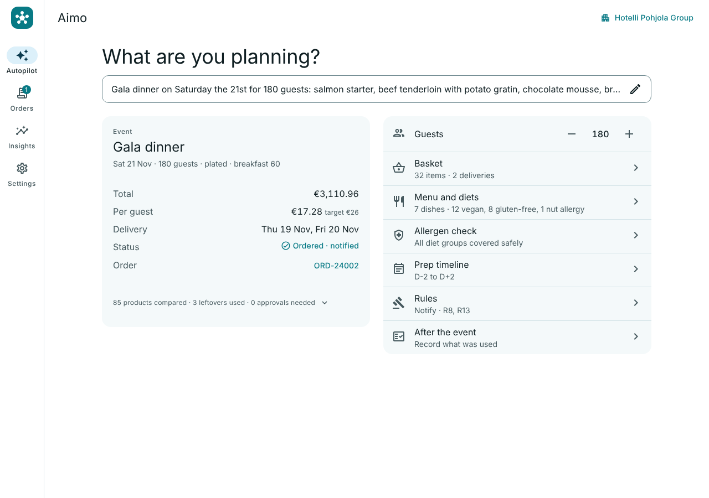

# Aimo Agent Gateway

**Junction 2026 · Valio Aimo challenge.** A prototype of the *interface and operating model* that lets an external purchasing agent find products, compare signed offers and order at fixed prices with the right human approval — on open, verifiable standards, without exposing Valio Aimo's real systems or data.

> **Live clickable MVP:** https://claude.ai/artifact/4PYHao2tm2PPmvCVTekwTp (self-contained page, works on a phone, opens with the gala example already run). Minimal Material 3: Autopilot · Orders · Insights · Settings. All data is synthetic; brands and suppliers are fictional.



## What it solves

| Organisers' question | Our answer | Where to see it |
| --- | --- | --- |
| Structured product / price / availability lookup | GS1-keyed catalog (L0, browse-only) + **signed Offer Attestations** (W3C VC 2.0 as JWS ES256, price fixed 15 min, stock fresh 5 min) | Autopilot → order → Products → *Signed offer* |
| Inquiry → commitment at fixed prices | Checkout re-verifies every offer and returns `offer_expired` / `price_changed` instead of charging differently | Demo scenario X1 |
| Permission & human approval | Signed **Intent Mandate** (named human) + deterministic **policy engine** (R0–R14, V1–V3; BLOCK > APPROVE > NOTIFY > AUTO); one consolidated approval card | Settings › Mandate; Orders → Waiting for approval |
| Partial availability, good-better-best | BEST/BETTER/GOOD with one-line trade-offs; up to 3 plans (split products / substitute / split dates), case rounding explicit | Agent → S2 |
| Human-readable audit trail | Append-only SHA-256 hash chain, templated sentences with rule ids, buyer vs Valio Aimo view, tamper test | Order detail; Settings › Audit log |
| Least manual correction | **Event Autopilot** (text or voice → brief → recipes → right-sized basket → one decision), learning from outcomes, evidence-backed recommendations | Autopilot, Insights |

## Run locally

```bash
python3 -m pip install -r requirements.txt   # starlette, uvicorn, pydantic, PyJWT[crypto], pyyaml, pytest
make run          # or: python -m gateway  → http://127.0.0.1:8000 (serves the MVP + reference endpoints)
make test         # pytest: planner worked example, policy rules, trust checks, audit tamper, preferences
make build        # rebuild ui/dist/index.html from ui/src (inline CSS/JS/data/icons)
```

The MVP page needs no server: open `ui/dist/index.html` directly. Optional real-API adapter: set `AIMO_BASE_URL` and `AIMO_API_KEY` (see `.env.example`); fixtures are used otherwise.

## Demo walkthrough (Settings › Demo scenarios, 13 steps)

The UI has four destinations — **Autopilot · Orders · Insights · Settings** — in a minimal Material 3 design (turquoise, white, sky blue). One input handles both events and plain orders; details open in bottom sheets. See `docs/UX.md`.

| Step | Scene | What happens | Judging criterion |
| --- | --- | --- | --- |
| S0 | **Event Autopilot** | “Gala dinner on Saturday the 21st for 180 guests: salmon starter, beef tenderloin with potato gratin, chocolate mousse, breakfast for 60 the next morning. 12 vegans, 8 gluten-free, one nut allergy.” → brief, diet variants, 32-line basket right-sized from history, 3 leftover lots netted, 37 signed offers, 2 deliveries, prep timeline → **ordered automatically (NOTIFY)** | End-to-end demo; least manual correction |
| S0+ | Guests → 200 | Whole basket re-scales with a delta table; event budget exceeded → **one** approval card | Autonomy & controls |
| S1 | Happy path | 1,000 L lactose-free milk, stock sufficient → AUTO | Autonomy |
| S2 | Partial stock | Preferred milk 640 L: P1 640+360 split (NOTIFY R4/R6, €1,304.40), P2 whole milk (APPROVE R5, €1,410), P3 later date (APPROVE R7, €1,290) | Matching need; robustness |
| S3 | Last-minute event | €3,418 multi-line order > €2,000 limit → approve 5 lines, reject the beef; override logged by name | Controls |
| S4 | Hospital, milk- & nut-free | Oat drink out of stock; nut drinks and “may contain nuts” filtered; soy → APPROVE R5; forced almond → **R1 BLOCK** | Robustness |
| S5 | Standing-order drift | +22 % vs 8-week median → R10 pauses auto-renew | Controls |
| X1 | Expired offer | 16 min pass and the price moves → `price_changed`; agent re-quotes; order at the new signed price | Trust |
| T | Tamper test | Edit one audit row → verification pinpoints the break | Openness |
| S6 | Learning → mandate | Apply “silent in-tolerance dairy swaps” (evidence n=5) → signed mandate v2 → S2 re-runs as **AUTO** | Least manual correction |
| S7 | Customise | Preset *Domestic & sustainable* + pin Maitokaari → ranking and choice change with visible reasons | Matching need |
| S8 | Event loop | Record usage (prefilled, one tap) → report: used / reused / wasted, CO₂e est., labels → next gala right-sized, leftovers netted | Waste, least correction |
| OPS | Valio Aimo ops | Decision mix, latency, blocked requests, demand & waste signals, per-agent kill switch (V3) | Production path |

## Repository

```
ui/src/            engine.js (planner, policy, trust, audit), flows.js (agent, approvals, history, insights, autopilot), ui.js (screens), styles.css (tokens)
ui/dist/index.html the self-contained MVP (also the published artifact)
gateway/           Python reference core: catalog, preferences, planner, policy + rules.yaml, trust, audit, signals, core, thin server
gateway/data/      catalog.json (97 products), buyers.json (3 buyer orgs), recipes.json (45 dishes)
tests/             pytest (27 tests)
docs/              ARCHITECTURE, UX, PROBLEM_SOLUTION, EVENT_AUTOPILOT, DATA_MODEL (+ data-model/ DDL & ER), API, STANDARDS, ROADMAP, ASSUMPTIONS, screenshots/
```

## Known gaps (honest list)

- The Python backend is a **reference skeleton** (core logic + thin server); the full REST/MCP surface is specified in `docs/API.md` and implemented client-side in the MVP. Not load-tested.
- Speech input uses the browser's Web Speech API; the artifact sandbox blocks the microphone, so the page offers a clearly labelled sample voice request.
- Prices, stock, history, weather/occupancy context and CO₂e factors are synthetic. The organisers' mock API was not reachable from the build sandbox; the adapter is ready for it.
- Keys are generated per page load / server start (demo only); production uses did:web, HSM-held keys and a status list.
