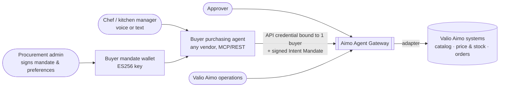
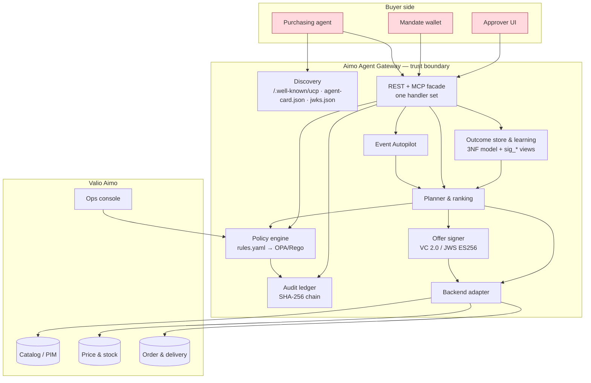
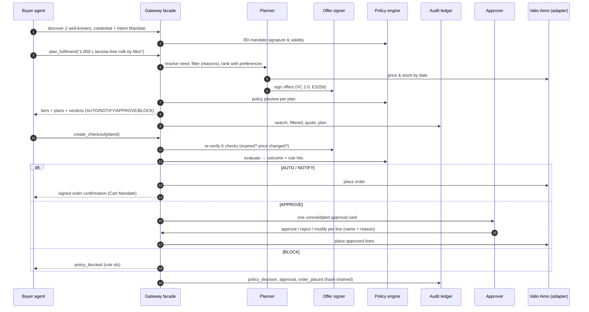
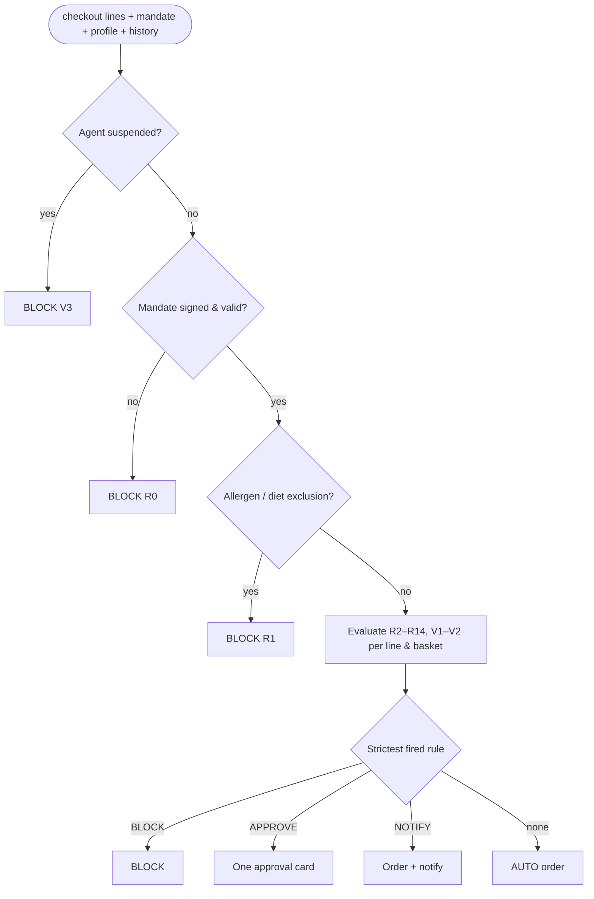
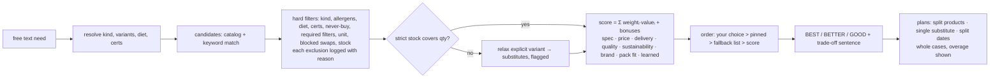
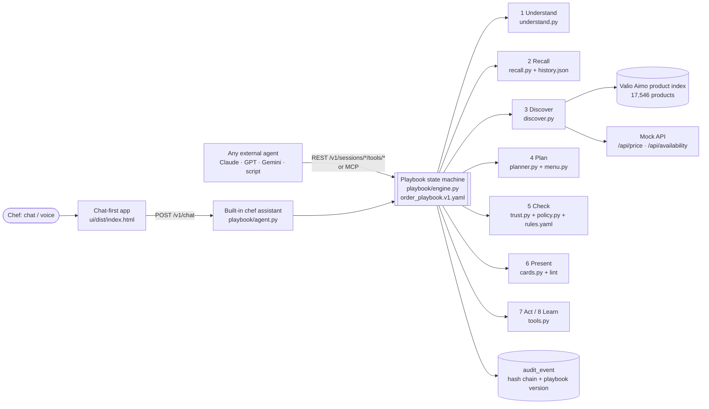
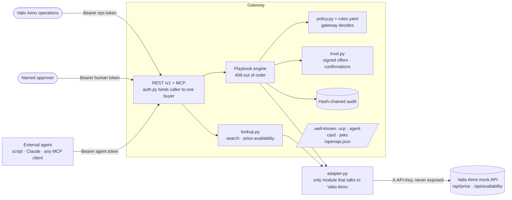
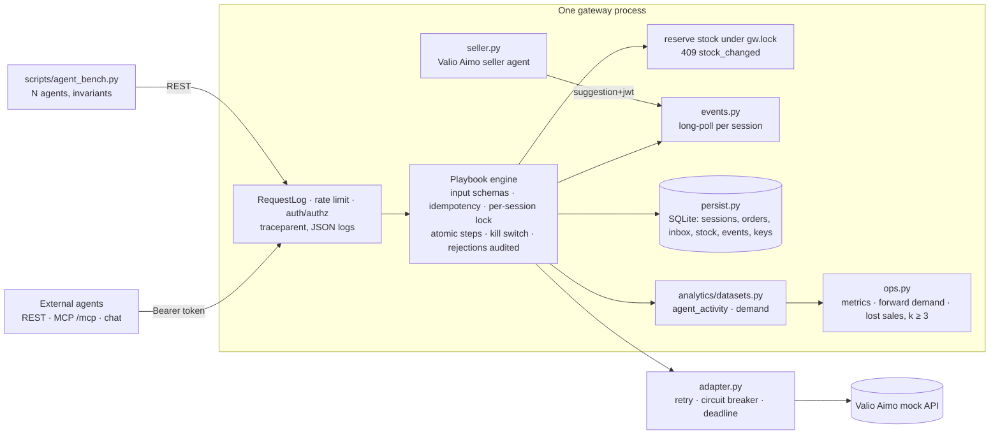

# Architecture

Principle: **the agent proposes; the deterministic gateway decides.** Every claim the agent acts on is signed; every decision is a rule id with a templated reason; every step is written by the gateway into a hash-chained ledger.

## 1. Context (C4 level 1)

## 2. Containers

## 3. Components and responsibilities

| Component | Responsibility | Standard | Code (MVP page / Python reference) |
| --- | --- | --- | --- |
| Discovery | Capability profile, signed agent card, JWKS | UCP-shaped profile, A2A agent card | `gateway/__main__.py` |
| Facade | One handler set as OpenAPI 3.1 REST and MCP tools | OpenAPI 3.1, JSON Schema 2020-12, MCP | `docs/API.md` |
| Planner | Need resolution → hard filters (logged) → case rounding → buyer-weighted score → tiers → ≤3 plans | GS1 GTIN, need groups | `engine.js planLine/buildPlans`, `gateway/planner.py` |
| Offer signer | Offer Attestations, 15-min price, 5-min stock freshness, status list | W3C VC 2.0 + JWS ES256 | `engine.js issueOffer/verifyOffer`, `gateway/trust.py` |
| Policy engine | R0–R14 (buyer mandate) + V1–V3 (Valio Aimo), strictest wins | rules.yaml (prod: OPA/Rego) | `engine.js policyEvaluate`, `gateway/policy.py` |
| Audit ledger | Append-only hash chain, templated sentences | EU AI Act Art. 12-style | `engine.js audit*`, `gateway/audit.py` |
| Event Autopilot | Brief → recipes → scaled, right-sized → leftovers → sourced → scheduled → one decision | — | `flows.js parseBrief/planEvent` (see EVENT_AUTOPILOT.md) |
| Outcome store | Curated ProcessRecord per request; labels, metrics, signals, recommendations | 3NF model in `docs/data-model` | `flows.js closeProcess/kpis/recommendations` |
| Adapter | Only place that touches Valio Aimo systems; fixtures or mock API | — | `gateway/adapter.py` |

## 4. Main sequence: request → order

## 5. Policy decision

## 6. Planner

## 7. Trust boundaries & deployment view

- **Boundary 1 (agent → gateway):** mutual TLS / OAuth client credential bound to one buyer account; per-agent rate limit (429 + Retry-After); kill switch (V3).
- **Boundary 2 (human → gateway):** mandates and preference profiles are signed by a named admin; approvals carry user id + display name.
- **Boundary 3 (gateway → Valio Aimo):** read-mostly adapter; only `place_order` writes; no customer data leaves Valio Aimo except what the buyer already owns.

Production deployment sketch: stateless gateway pods behind an API gateway; PostgreSQL (3NF model, partitioned by month), append-only audit table with periodic hash anchoring; OPA sidecar for policy bundles; HSM/KMS-held ES256 keys published via did:web; event stream (L1 raw, 90 days) → refined L2 tables → L3 views.

## 8. Key decisions (short ADRs)

| # | Decision | Alternatives considered | Why |
| --- | --- | --- | --- |
| ADR-1 | Deterministic policy engine decides; LLM only proposes/parses | LLM-as-judge; human-only approval | Explainable, testable, auditable; rule ids map to plain language |
| ADR-2 | Offers as W3C VC 2.0 secured with compact JWS ES256 | Plain signed JSON; mTLS only; blockchain | Open, verifiable offline, works with JWKS/did:web; no platform lock-in |
| ADR-3 | One handler set, two facades (REST + MCP) | MCP only; REST only | Agent vendors differ; one behaviour, one audit |
| ADR-4 | Strictest-rule-wins outcome model | Weighted risk score | Predictable for buyers and Valio Aimo; easy to explain |
| ADR-5 | Hash-chained append-only audit written by the gateway | Agent-side logs; external ledger | Tamper evidence without new infrastructure; anchorable later |
| ADR-6 | Separate outcome store (3NF + views) from audit | Analytics on raw logs | Data minimisation; governed metrics; fast queries |
| ADR-7 | Preference profile separate from mandate, referenced by version | Preferences inside mandate | Mandate = authority (rarely changes); preferences = taste (often changes) |
| ADR-8 | Event Autopilot as a deterministic pipeline over the same planner/policy | Free-form LLM shopping list | Same guardrails; every quantity has a why |
| ADR-9 | MVP logic client-side in one page; Python core as reference | Server-only demo | Demo must run on a phone without localhost |

## 9. v2: the playbook rails and the chat-first app

Since v2 every agent works through a **versioned playbook** enforced by the gateway.

- **One state machine, three facades.** The chat assistant, REST and MCP all call
  `Engine.call(session, tool, args)`. Order is enforced there: out-of-order → 409
  `step_not_allowed` with `next_allowed_tools`; wrong output shape → 422.
- **Check is gateway-run.** `check_basket` is audited as `system:gateway`; Act only
  accepts what Check decided (auto / tell me directly, needs OK after an approval).
- **Rewinds.** Chef changes go back to the right step (new guest count → Understand;
  pick, tip or safe alternative → Plan) and everything downstream runs again.
- **Two assortments, one shape.** Seeded customers use the curated demo assortment
  (repeatable golden tests). Kitchens on the live assortment, and needs the curated
  set lacks, use the real Valio Aimo product data, bridged into the planner's product
  shape (`discover.bridge`) with live price and availability when the API key is set.
- **Replayable.** Each call is an `audit_event` with step, playbook version, inputs
  and duration; the golden scenarios in `tests/playbook/` replay whole runs.
- **Data model.** Sessions map to `purchase_process` (`process_id` = session id,
  `tool_call_count`), outcome labels to `outcome_label`, audit to `audit_event`.
  Storage in the MVP is in-memory + SQLite for the audit chain.

| ADR | Decision | Why |
|---|---|---|
| ADR-10 | Versioned playbook file + server-side state machine | Any agent vendor can follow it; refinements are diffs to one file guarded by golden tests |
| ADR-11 | Recall before Discover; Discover locked without gaps | Least manual correction: start from what the kitchen already trusts; fewer API calls |
| ADR-12 | Answers as linted cards | Plain language is enforced, not hoped for |
| ADR-13 | Learn silently only from right-sized runs; ask (Tip) after repeated over-ordering | Chefs stay in control of changes they did not ask for |
| ADR-14 | Recorded gateway runs for the offline page | The artifact shows real gateway output without a server |

## 10. v4: the agent-facing surface (challenge audit)

Commitment path (v4): `plan_basket` issues signed offers (15 min) → `check_basket` (gateway) → `place_order {offerIds}` or `request_approval` → named human's inbox → `POST /v1/approvals/{id}` (human only) → `place_order {offerIds}` → signed `order+jwt` confirmation. Checklist: [CHALLENGE_CHECKLIST.md](CHALLENGE_CHECKLIST.md); exposure: [EXPOSURE.md](EXPOSURE.md).

## 11. v5: many agents at once, the seller agent and the operations view

- **Order time is the moment of truth.** `place_order` re-verifies every offer with the planned quantity and reserves the stock atomically; a loser gets `409 stock_changed` and re-quotes. Retries with an `Idempotency-Key` return the first order.
- **Agents are told, not polled.** Every step, decision, approval, order, expiring offer and seller suggestion is a session event; `GET /v1/sessions/{id}/events?wait=25` or MCP `wait_for_update` wakes the agent.
- **The seller is another agent with less power.** It writes signed, promotional suggestions into the buyer's event stream; only the buyer's agent can use one, and only through `plan_basket` → `check_basket`.
- **Valio Aimo learns from the channel.** Sessions and plans become the `agent_activity` and `demand` datasets: buyers query their own rows through the insight rails; operations see cross-customer aggregates with k ≥ 3.
- **Proof.** `make bench` runs N agents at once over REST and checks no oversell, one order per key, verified offers, authority, named approvers and the audit chain from the gateway's own records ([BENCH.md](BENCH.md)).
