# Event Autopilot

**One input, one review screen, one tap (or zero taps within the mandate).** The chef says what the event is, what will be cooked and for how many; the pipeline removes the manual work: catalog searching, quantity maths, comparing products, stock and leftover checks, allergen checking, approval chasing, delivery timing and post-event bookkeeping.

```mermaid
flowchart LR
  in([Text or speech<br/>EN / FI]) --> u[1 Understand<br/>Event Brief: type, date, services,<br/>guests, diets, allergies, style]
  u -->|missing date/guests| q{{ask ONE question,<br/>otherwise assume & label}}
  u --> m[2 Menu<br/>dishes → recipe KB<br/>unknown → nearest template, flagged]
  m --> d[Diet split<br/>safe variant per group:<br/>vegan, gluten-free, allergies]
  d --> i[3 Ingredients<br/>guests × portion ÷ yield<br/>+ buffer plated 5 % / buffet 10 %<br/>× learned per-guest use]
  i --> n[4 Net<br/>leftover lots by best-before<br/>standing orders checked]
  n --> s[5 Source<br/>need groups + preference profile<br/>signed offers, plans, pack-size fit]
  s --> t[6 Schedule<br/>fresh D-1, dry/frozen D-2<br/>prep timeline D-2…D+1]
  t --> p{7 Decide<br/>whole-basket policy:<br/>R1 allergens, R2 per event,<br/>R13 right-sizing, R14 per guest}
  p -->|AUTO / NOTIFY| o[Order automatically<br/>signed confirmations]
  p -->|APPROVE| a[ONE consolidated approval]
  o --> f[Follow through:<br/>guest change → re-scale & top-up,<br/>reconcile prefilled → learning]
  a --> f
```

## Steps in detail

| Step | Deterministic logic (MVP: `ui/src/flows.js`) |
| --- | --- |
| Understand | `parseBrief`: event type keywords (gala, pikkujoulut, wedding…), dates (“Saturday the 21st”, “perjantaina”, “next Saturday”, 21.11.), guests (“180 guests”, “120 hengelle”), diet counts (“12 vegans”, “6 vegaania”, “8 gluten-free”), allergies by the 14 EU allergens (“one nut allergy”, “pähkinäallergia”), extra services (“breakfast for 60 the next morning”), style (buffet/plated or assumed). Optional LLM parsing can replace this step behind a flag. |
| Menu | 45-dish recipe KB (`gateway/data/recipes.json`) incl. Finnish classics (kinkku, lanttulaatikko, porkkanalaatikko, rosolli, riisipuuro, lohikeitto, karjalanpiirakka, poronkäristys, silakat). “laatikot” expands to both casseroles. Kitchen recipes can override defaults (roadmap). |
| Diet split | For each dish and group: if the dish is incompatible (diet tags, allergens, “may contain”), portions move to the dish's safe variant; ingredient lines inherit the group's hard constraints (e.g. `excludeAllergens: [nuts]`). |
| Scale & right-size | `baseline = portions × qty/portion ÷ yield`, `× (1 + buffer)`, `× factor` where factor = median(actual/planned per guest) over the last 3 reconciled events of the same type (clamped 0.6–1.15). Every change > 10 % fires R13 (NOTIFY; > 30 % APPROVE). |
| Net | Leftover lots of the same need with best-before ≥ need-by are used first and shown (“12 L whipping cream left from Board dinner…”). |
| Source | The normal planner with the buyer's preference profile; broken cases (packs) allowed when case rounding would over-order > 10 %. |
| Schedule | Shelf life ≤ 7 days → D-1, otherwise D-2; consolidated per date; prep tasks from recipes. |
| Decide | Policy on the whole basket with event context (per-event budget, per-guest target). |
| Follow through | Guest change re-plans with already-ordered stock reserved and orders only the delta; reconciliation prefilled from expected use; event report with outcome labels feeds per-guest learning and leftover lots. |

## “What I did for you”
Counts shown to the user: dishes understood, ingredients calculated, products searched, signed offers compared, allergen checks, leftover lots checked, lines right-sized, approvals needed, and an estimate of minutes saved (searches × 1.5 + offers × 1 + ingredients × 2 + allergen checks × 0.2 + leftovers × 1.5 + 20 min bookkeeping + approval chasing).

## API & MCP (target contract)
`POST /v1/events/intake` (text → EventBrief) · `POST /v1/events/{id}/plan` (basket, timeline, decisions) · `PATCH /v1/events/{id}` (guests → re-scale, delta) · `POST /v1/orders/{id}/reconciliation` · `GET /v1/events/{id}/report` · MCP `plan_event_from_brief`, `record_consumption`, `get_waste_insights`, `get_leftovers`.
