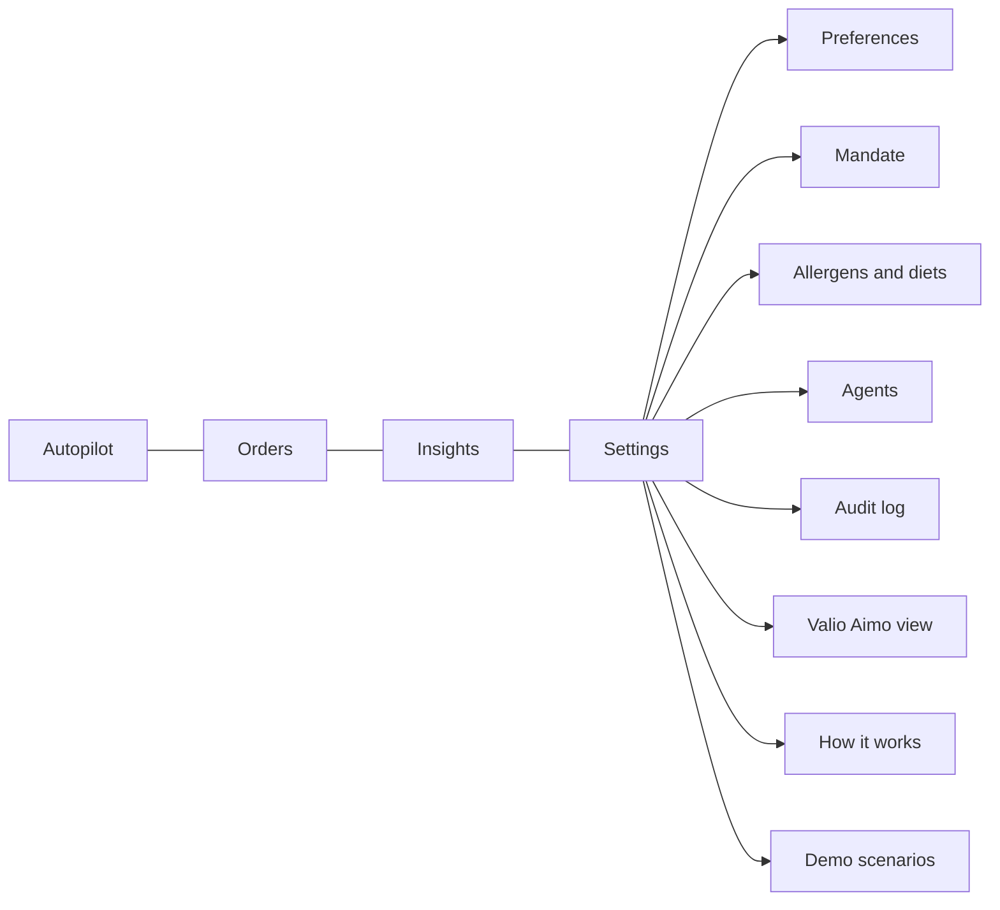
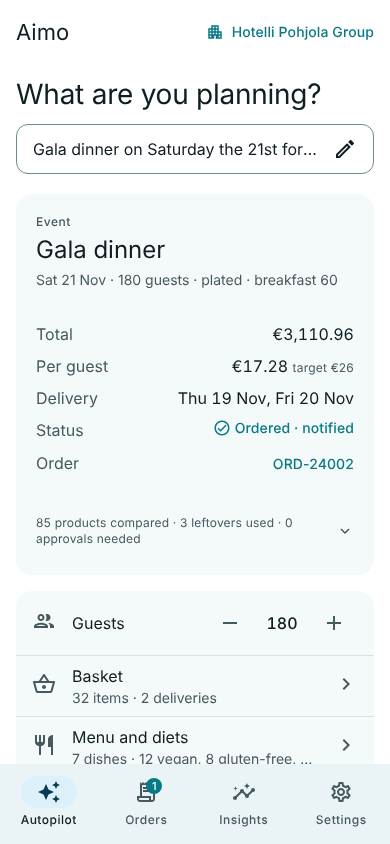
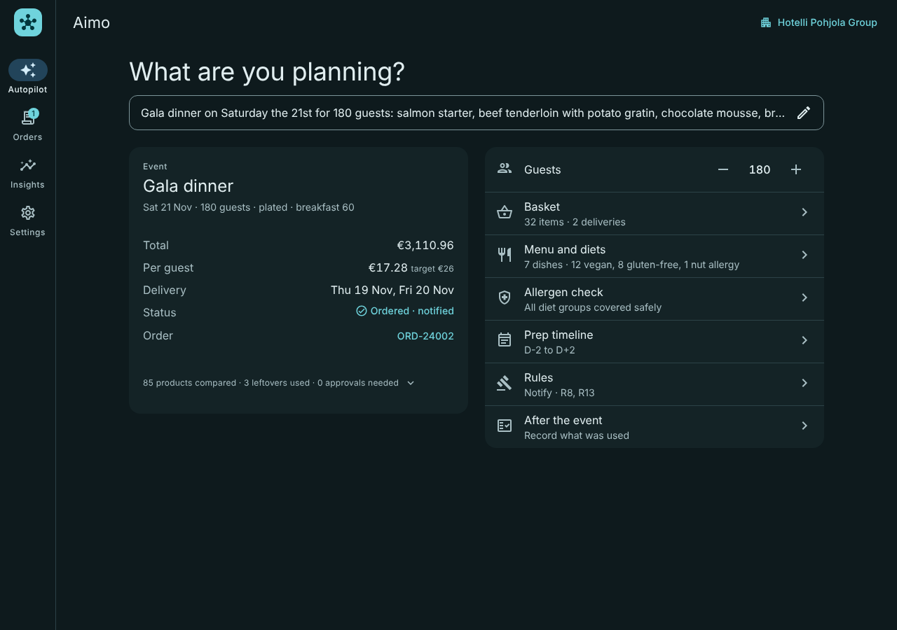
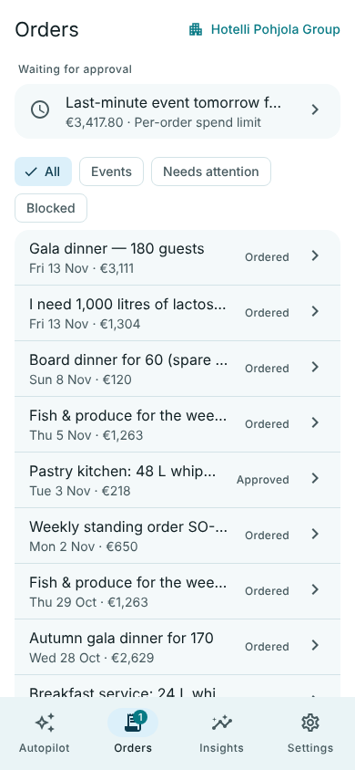
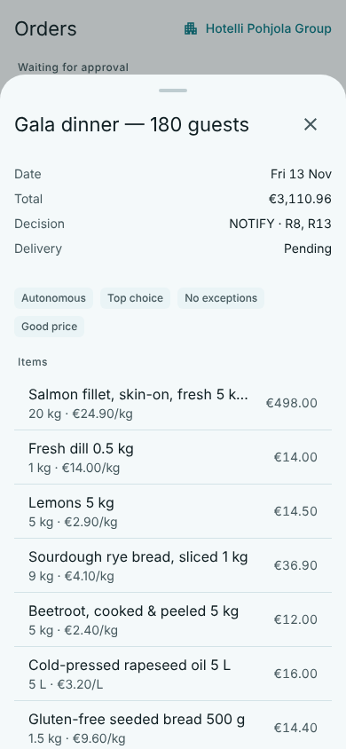
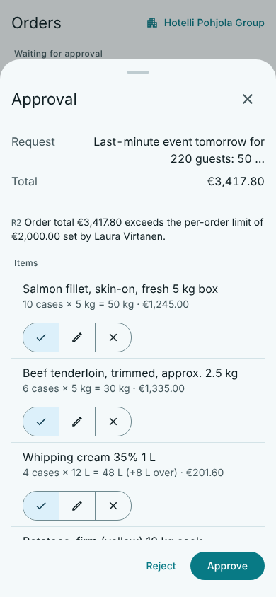
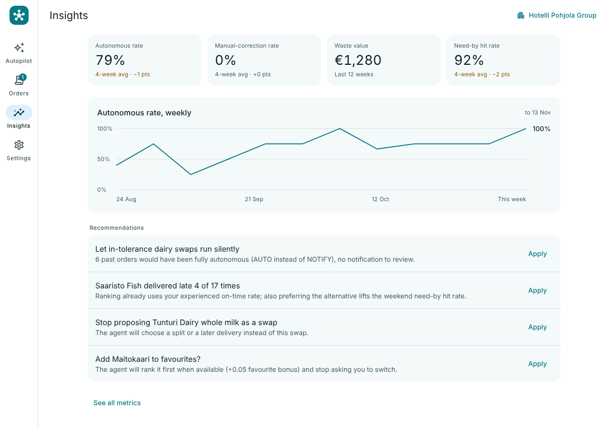
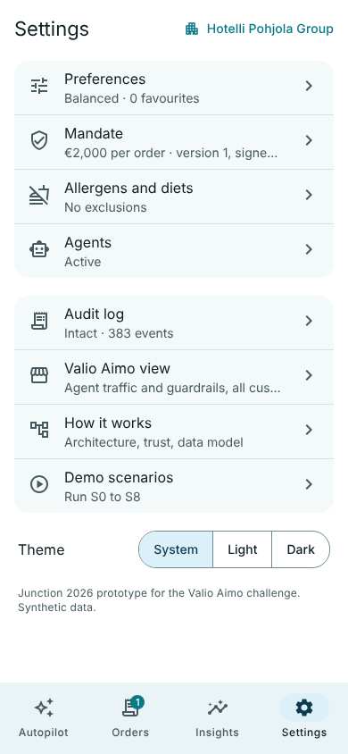

# UX specification (v2, minimal Material 3)

The first UI was judged too busy. v2 strips it back to standard Material 3: fewer screens, one main action per screen, details in bottom sheets, short sentence-case text, and three colours.

## Design tokens (single source: `ui/src/styles.css`)

| Role | Light | Dark | Use |
| --- | --- | --- | --- |
| Primary (turquoise) | `#087a85` (5.1:1 on white) | `#6fd3dc` | Filled buttons, active states, chart line, "ordered" status |
| Surface (white) | `#ffffff` | `#0e1a1d` (blue-grey tuned to the turquoise hue) | Page background |
| Secondary container (sky blue) | `#dcf0fa`, accent `#87ceeb` | `#22445a`, accent `#8fc9e3` | Selected nav item, selected chips/segments, tonal buttons, "kept" bar segment |
| Surface containers | `#f4f9fa` / `#eaf4f6` / `#ddedf0` | `#142326` / `#18292d` / `#203438` | Cards, lists, sheets (turquoise-tinted neutrals) |
| Text | `#0f1e22`, variant `#46595e` | `#e1eef0`, variant `#a9bfc4` | ≥ 4.5:1 on their surfaces |
| Block / approve | `#b3261e` / `#8a5a00` | `#f2b8b5` / `#e6c27a` | Small status text and icons only |

Type: Figtree, M3 scale (display 36/44 used once per screen, headline 24/32, title 22/28 and 16/24, body 16/24 and 14/20, label 12/16). Spacing on an 8dp grid; corner radius 12–16dp (sheets 28dp). No gradients, glows or emoji; no shadows except the snackbar and menus.

## Navigation

Phone: navigation bar with 4 destinations. Desktop (≥ 840px): navigation rail. Top app bar: screen title, organisation switcher on top-level screens, back arrow on Settings pages. Approvals waiting show as a badge on Orders.

## Screens

### Autopilot
 

- One input, "What are you planning?", with a mic button inside the field, plus **Examples** (text button) and **Plan** (filled button). After planning it collapses to a one-line field (tap to edit) so the result fits above the fold on a phone.
- The same input takes events ("Gala for 180…") and plain orders ("1,000 L lactose-free milk by Monday"). Lines with L or kg go to the purchasing agent; everything else becomes an event brief. "Now 200 guests" re-scales the current event.
- Result: one summary card with type, title, date, guests, total, per guest vs target, delivery dates, status, and the order link or **Approve and order**. One quiet line follows, e.g. "85 products compared · 3 leftovers used · 0 approvals needed"; it expands to the full count.
- Below the card (beside it on screens ≥ 1100px) is one list. Event: guests stepper, basket, menu and diets, allergen check, prep timeline, rules, after the event. Plain order: options, products, rules. Each row opens a bottom sheet.

### Orders

"Waiting for approval" sits first, then filter chips (All, Events, Needs attention, Blocked) and the list. Each row shows request, date, total and a status label. Tapping a row opens the detail sheet: key facts, outcome labels, items, substitutions, rules, agent steps (expandable) and the audit trail (expandable). Tapping an approval opens the approval sheet, with per-line approve, change or reject, the approver and a note.

 

### Insights

Four headline metrics: autonomous rate, manual corrections, waste value and need-by hit rate. Each tile opens its governed definition. Below are one single-hue trend chart and up to five recommendations, one line each with **Apply**; tapping a row shows the evidence and context. **See all metrics** opens all 14 governed metrics, the most-wasted products and the leftovers in stock.

### Settings

The list contains:
- Preferences: preset segmented button, weight sliders, live ranking, "Prefer" chips, favourites, pinned products.
- Mandate: limits, substitute rules, sign.
- Allergens and diets.
- Agents (kill switch).
- Audit log: verify and tamper test.
- Valio Aimo view.
- How it works: architecture, trust, data model, standards.
- Demo scenarios: runs S0–S8 as a plain list, with no overlay tour.
- Theme: System, Light or Dark.

## Components used
Top app bar, navigation bar and rail, cards (filled tonal surface), list items (one or two lines, leading icon, trailing text or chevron), filled, tonal and text buttons, icon buttons (48dp), outlined text fields, segmented buttons, sliders, switches, filter chips (only where filtering), bottom sheets (centred dialogs on desktop), menus and snackbars.

## States
- **Loading:** "Preparing demo data…"
- **Busy:** the Plan button reads "Planning…" and is disabled.
- **Empty lists:** a short sentence.
- **Errors:** a snackbar ("Something went wrong. …"). Reconciliation validation errors also use the snackbar.
- **Voice unavailable:** an inline one-line note.
- **Blocked order:** the reason as a one-line block-coloured sentence.

## Accessibility
- **Contrast:** text ≥ 4.5:1 in both themes.
- **Touch targets:** 48dp for all compact controls; chips and buttons get an invisible extended hit area.
- **Focus:** a visible ring on every control.
- **Screen readers:** ARIA labels on icon buttons, `aria-current` on navigation, `aria-pressed` on chips, `role=dialog` sheets with focus moved to Close, Esc closes, and the chart has a text alternative with its latest value.
- **Motion:** respects reduced motion.

## Copy rules
Sentence case, plain verbs ("Plan", "Approve and order", "Record usage"). No exclamation marks, marketing words or UI self-explanations. Rule reasons are templated sentences with numbers and the rule id.
