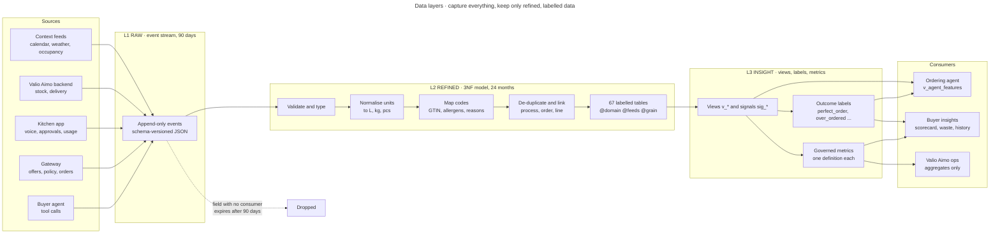
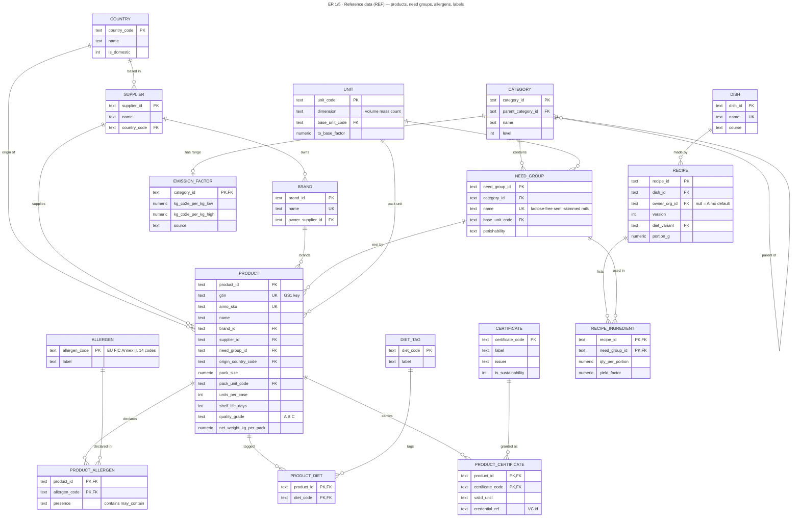
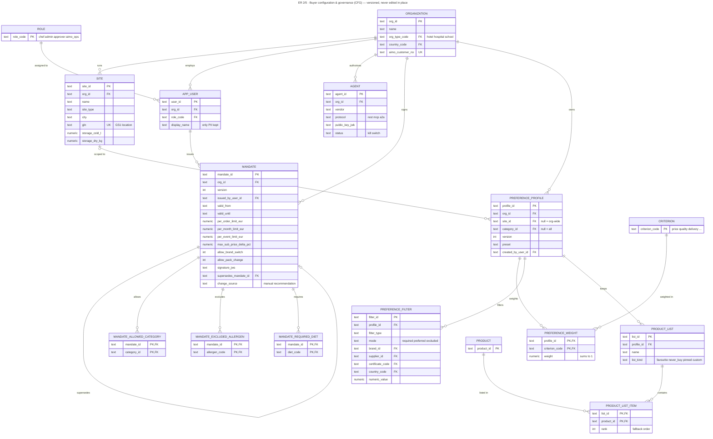
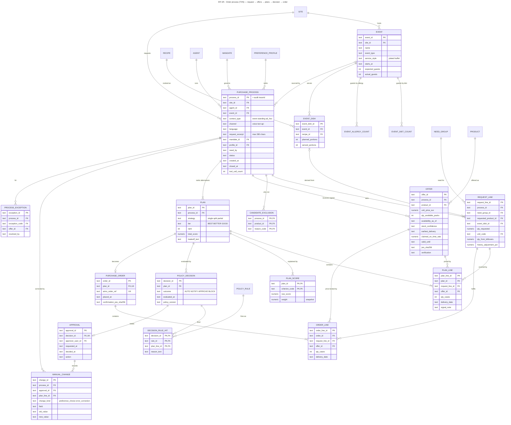
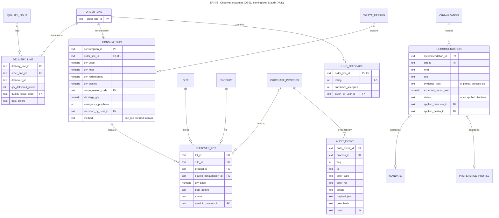
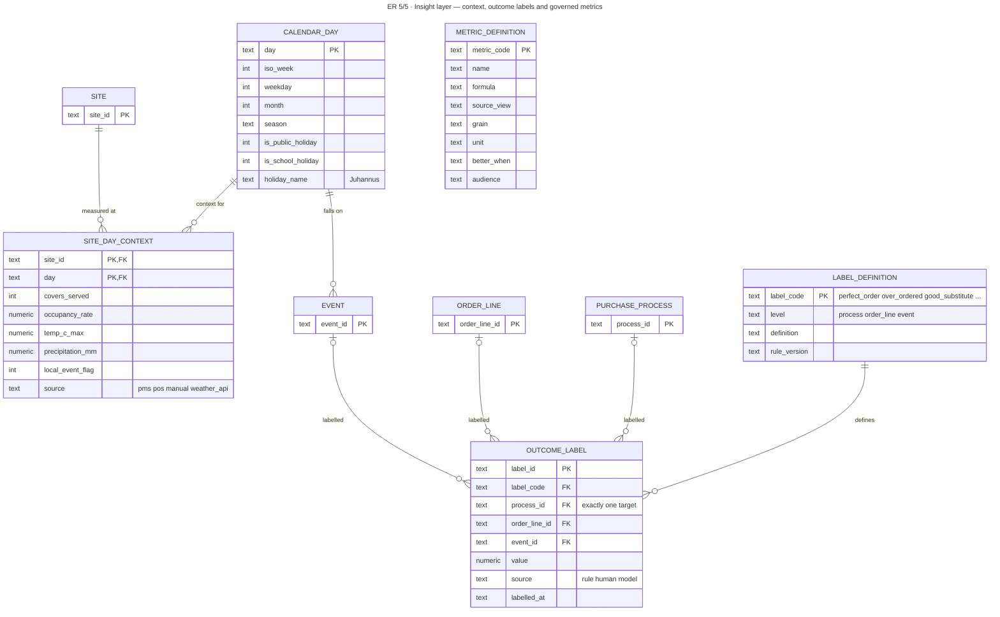
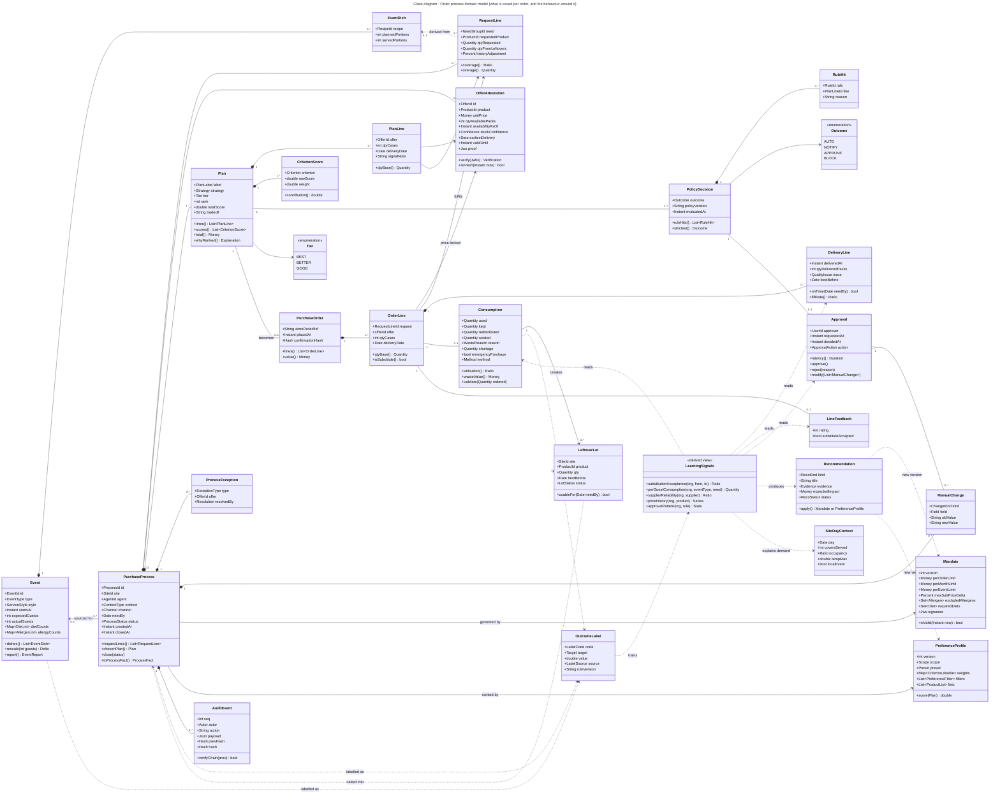

# Aimo Agent Gateway — Order Process Data Model

Version 1.1 · 14 Nov 2026 · 3NF base tables + derived analytics views

This model saves **everything an order process produces** — the request, every candidate and why it lost, signed offers, ranked plans with per-criterion scores, the policy decision and fired rules, human approvals and corrections, the order, delivery, usage and waste, feedback, recommendations and the audit chain — so it can be queried for two purposes:

- **@agent** — make the ordering agent more precise (right-sizing, substitution ranking, supplier reliability, price judgement, mandate tuning).
- **@insight** — give buyers and Valio Aimo comprehensive reports (past processes, scorecards, waste, approvals, sustainability).

**Principle: capture as much as possible, store only refined data.** Every signal is captured in a raw event stream; it is promoted into the refined model only once it is typed, unit-normalised, coded, de-duplicated, linked to its process and labelled with a consumer. Nothing is stored "just in case" in the refined layer, and nothing useful is thrown away before it has been refined. Personal data stays minimal (user id and display name for accountability, a 280-character request excerpt, no voice recordings or LLM transcripts).

## Data layers

| Layer | What | Retention |
| --- | --- | --- |
| L1 Raw | Append-only, schema-versioned event stream from agent, gateway, kitchen app, Valio Aimo backend and context feeds | 90 days |
| L2 Refined | This 3NF model: validated, typed, unit-normalised (L, kg, pcs), coded, de-duplicated, linked, labelled | 24 months |
| L3 Insight | Views (`v_*`, `sig_*`), outcome labels and governed metrics | Rebuildable |

## Files

| File | Contents |
| --- | --- |
| `schema.sql` | Complete DDL: 67 base tables, indexes, 10 derived views (validated on SQLite; PostgreSQL notes inline) |
| `catalog_seed.sql` | 12 outcome-label definitions and 14 governed metric definitions |
| `queries.sql` | 10 example queries tagged @agent / @insight |
| `er_1_reference` … `er_5_insight` (.mmd/.svg/.png) | ER model split into five domains
| `data_layers` (.mmd/.svg/.png) | Raw → refined → insight pipeline |
| `class_diagram` (.mmd/.svg/.png) | Domain class model with behaviour |

## Labels on every table

| Label | Values | Meaning |
| --- | --- | --- |
| `@domain` | REF · CFG · TXN · OBS · AUD · DER | Reference/master · buyer configuration (versioned) · order-process transactions · observed outcomes after the order · tamper-evident audit · derived views |
| `@feeds` | AGENT · INSIGHT · TRUST | Which consumer needs the data; a field with no consumer is not stored |
| `@grain` | one row per … | What a row means, so aggregations never double-count |
| `@pii` | none · low | Personal-data exposure |

## Normalisation (3NF) rules applied

1. **1NF** — no lists in columns: allergens, diets, certificates, mandate exclusions, weights, list items, rule hits and dietary guest counts are their own junction tables.
2. **2NF** — composite keys (e.g. `product_allergen`, `plan_score`, `decision_rule_hit`) carry only attributes of the whole key.
3. **3NF** — no transitive dependencies: org comes via `site`, category via `need_group`, product and price via `offer`, process via `plan`. Totals, coverage, base-unit quantities, utilisation and rates are **never stored**; they are computed in `v_*` views.
4. **Snapshots that are not duplicates** — `plan_score.weight` and offer prices are facts *at decision time* (profiles and prices change later), so storing them is correct, not redundant.
5. **Codes are lookup tables** (policy rules, criteria, exclusion/waste/exception reasons, allergens, diets, certificates) so every dimension can be grouped and filtered reliably.
6. **Versioned configuration** — mandates and preference profiles are new rows per change (`supersedes_*`, `version`), so every past decision can be explained with the rules that applied then.

## Table catalogue

| Table | Domain / feeds |
| --- | --- |
| `country` | REF @feeds INSIGHT |
| `unit` | REF @feeds AGENT,INSIGHT |
| `org_type` | REF @feeds INSIGHT |
| `organization` | lookup / junction |
| `site` | REF @feeds AGENT,INSIGHT |
| `role` | REF @feeds TRUST |
| `app_user` | REF @feeds TRUST @pii low |
| `agent` | REF @feeds TRUST,INSIGHT |
| `supplier` | REF @feeds AGENT,INSIGHT |
| `brand` | REF @feeds AGENT,INSIGHT |
| `category` | REF @feeds AGENT,INSIGHT |
| `need_group` | REF @feeds AGENT,INSIGHT |
| `product` | REF @feeds AGENT,INSIGHT |
| `allergen` | REF @feeds AGENT |
| `product_allergen` | REF @feeds AGENT |
| `diet_tag` | REF @feeds AGENT |
| `product_diet` | lookup / junction |
| `certificate` | REF @feeds AGENT,INSIGHT |
| `product_certificate` | lookup / junction |
| `emission_factor` | REF @feeds INSIGHT |
| `dish` | REF @feeds AGENT,INSIGHT |
| `recipe` | CFG @feeds AGENT |
| `recipe_ingredient` | CFG @feeds AGENT |
| `calendar_day` | REF @feeds AGENT,INSIGHT |
| `label_definition` | REF @feeds INSIGHT |
| `metric_definition` | REF @feeds INSIGHT |
| `policy_rule` | lookup / junction |
| `criterion` | lookup / junction |
| `exclusion_reason` | lookup / junction |
| `exception_type` | lookup / junction |
| `waste_reason` | lookup / junction |
| `quality_issue` | lookup / junction |
| `mandate` | CFG @feeds AGENT,TRUST |
| `mandate_allowed_category` | lookup / junction |
| `mandate_excluded_allergen` | lookup / junction |
| `mandate_required_diet` | lookup / junction |
| `preference_profile` | CFG @feeds AGENT |
| `preference_weight` | lookup / junction |
| `preference_filter` | lookup / junction |
| `product_list` | lookup / junction |
| `product_list_item` | lookup / junction |
| `event` | TXN @feeds AGENT,INSIGHT |
| `event_diet_count` | lookup / junction |
| `event_allergy_count` | lookup / junction |
| `event_dish` | lookup / junction |
| `purchase_process` | TXN @feeds AGENT,INSIGHT,TRUST |
| `request_line` | lookup / junction |
| `candidate_exclusion` | lookup / junction |
| `offer` | TXN @feeds AGENT,TRUST,INSIGHT |
| `plan` | lookup / junction |
| `plan_score` | lookup / junction |
| `plan_line` | lookup / junction |
| `policy_decision` | TXN @feeds AGENT,TRUST,INSIGHT |
| `decision_rule_hit` | lookup / junction |
| `approval` | TXN @feeds AGENT,INSIGHT,TRUST |
| `manual_change` | lookup / junction |
| `process_exception` | lookup / junction |
| `purchase_order` | TXN @feeds INSIGHT,TRUST |
| `order_line` | lookup / junction |
| `delivery_line` | OBS @feeds AGENT,INSIGHT |
| `consumption` | OBS @feeds AGENT,INSIGHT |
| `leftover_lot` | OBS @feeds AGENT |
| `line_feedback` | OBS @feeds AGENT,INSIGHT |
| `recommendation` | lookup / junction |
| `site_day_context` | OBS @feeds AGENT,INSIGHT |
| `outcome_label` | lookup / junction |
| `audit_event` | lookup / junction |

## Derived views (fast query layer)

| View | Grain | Powers |
| --- | --- | --- |
| `v_order_line_fact` | ordered line | Base-unit qty, value, price per base unit, substitute flag |
| `v_process_fact` | process | Scorecard: outcome, tier, rank chosen, value, corrections, exceptions |
| `v_usage_fact` | ordered line with usage | Utilisation, waste rate and value |
| `v_request_fulfilment` | request line | Coverage, case-rounding overage, leftovers netted |
| `sig_substitution_acceptance` | org × from → to product | Ranking bonus/penalty with evidence n |
| `sig_per_guest_consumption` | org × event type × style × need | Right-sizing next events |
| `sig_supplier_reliability` | org × supplier | Experienced on-time, fill and quality rates |
| `sig_price_history` | org × product × month | "Is today's price good?" |
| `sig_approval_pattern` | org × rule | Mandate tuning recommendations |
| `v_agent_features` | org × need group | One row of everything the planner reads (use per guest, waste rate, substitute acceptance, over-order count) |

In production these become materialised views refreshed when a process closes; `audit_event` and `offer` are partitioned by month.

## Outcome labels (refined "was this good?" layer)

Labels are materialised by versioned rules when a process, line or event closes (humans can override). They make insight queries one-liners and give the agent a labelled evaluation set.

| Label | Level | Rule (v1) |
| --- | --- | --- |
| perfect_order | event | utilisation ≥ 95% on every line, no shortage |
| right_sized | line | utilisation 90–100%, no shortage |
| over_ordered | line | kept + wasted > 10% of ordered |
| under_ordered | line | shortage or emergency purchase |
| good_substitute / bad_substitute | line | substitute accepted and rated ≥ 4 / rejected or rated ≤ 2 |
| price_good | line | price ≤ buyer's 8-week average |
| late_delivery | line | delivered after need-by |
| autonomous · corrected · top_choice · exception_free | process | AUTO/NOTIFY · error correction made · rank-1 plan ordered · no exceptions |

## Context data (explains demand)

`calendar_day` (weekday, season, Finnish public and school holidays) and `site_day_context` (covers served, occupancy, temperature, rain, local events) let the agent learn that, for example, breakfast milk per guest drops in summer or rises on conference days.

## Governed metrics (semantic layer)

`metric_definition` holds the single definition of each KPI (formula, source view, grain, unit, better-when, audience): autonomous rate, manual-correction rate, top-choice rate, utilisation, waste value and rate, coverage, rounding overage, need-by hit rate, fill rate, approval latency, substitute acceptance, spend, exceptions per process. Dashboards may only use these, so every number means the same thing everywhere.

## ER model

## Class diagram

## Example queries

See `queries.sql` (Q1 event waste report · Q2 right-sizing · Q3 leftover netting · Q4 substitution evidence · Q5 supplier reliability · Q6 monthly scorecard · Q7 mandate tuning · Q8 price check · Q9 waste trend · Q10 why-not report).

## Retention

| Data | Retention |
| --- | --- |
| Process, order, outcome tables | 24 months |
| Raw event stream (L1) | 90 days |
| Learning signals (views) | rolling 12-month window |
| `audit_event` | at least 6 months (EU AI Act logging floor as best practice) |
| `app_user.display_name` | while the user is active; pseudonymised after |
